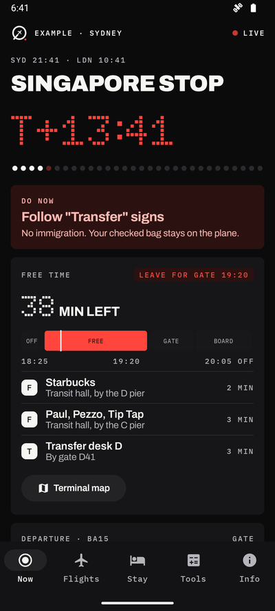
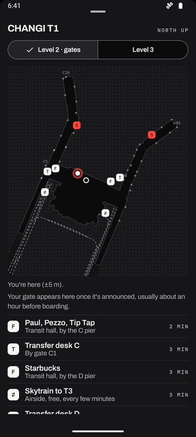
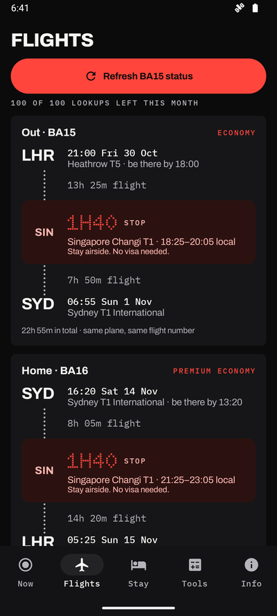
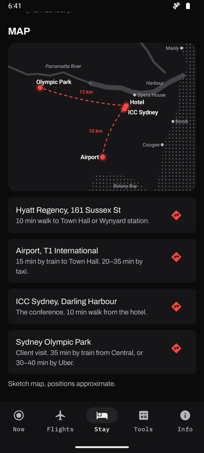
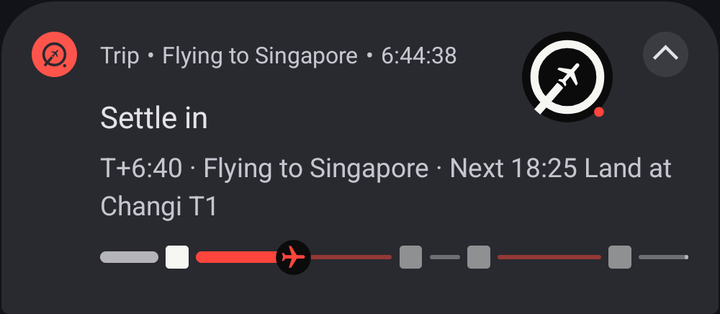
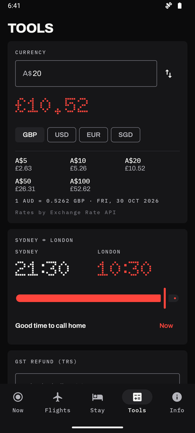
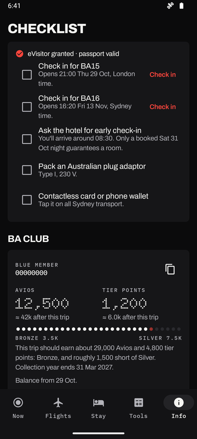

# Trip planner

Tell your coding agent about a trip; get a personal Android app for it on your phone.

A live "what to do now" timeline, a lock-screen status card, flight gates and gate-change alerts,
terminal maps with your GPS position, your hotel and places, and travel tools — built from your
booking details, checked leg by leg, and installed for you.

<p align="center">
  
  
  
  
</p>
<p align="center">
  
</p>

## Setup prompt

Paste into Claude Code, Codex, or any agent with shell access:

```text
Set up https://github.com/digitaljohn/trip-planner for me.

Read install.md first. It covers:
- cloning the repo
- checking Java and the Android SDK (ask me before installing anything big)
- registering the skill with whichever agent you're running under
- setting up the Aviationstack key (ask me to paste it when you need it)

Then read SKILL.md for how trips work.

After install, don't start a trip. Just tell me it's ready and wait.
```

Then start your agent wherever you like and tell it about the trip, from any source it can reach:

> set up my Sydney trip — the booking confirmations are in my Gmail

> here are my flights and hotel: [pasted itinerary, PDFs, screenshots]

> my trip's in my calendar for next week; build me the app

Booking emails, calendar events, documents in a connected drive, files on disk, or details typed
into the chat all work, in any mix.

It reads your bookings, asks for anything missing, plays the trip back to you in plain English,
waits for your OK, builds the app, checks every leg on an emulator, and installs it on your phone.
Everything for the trip is kept in its own folder (it suggests `~/Trips/<trip>/` unless you're
already in one): the trip itself (`MyTrip.kt`), your private numbers
(`trip.properties`), notes for next time (`project.md`) and the app (`out/trip.apk`). This repo
never holds anyone's trip.

## What's in the app

- **Now**: where you are in the trip, what to do, a countdown to the next step, and a free-time
  budget at each departure airport.
- **Lock screen**: an Android 16 Live Update with the current step, gate or belt, and progress.
- **Live flights**: gates, delays and belts from Aviationstack's free plan, with alerts when a gate
  is announced or changes, and an explicit refresh button. Lookups are rationed to the quota.
- **Terminal maps**: real outlines and gates from OpenStreetMap, with your GPS position, the route
  to your gate, trains between terminals, food, showers and smoking areas.
- **Stay, tools and info**: hotel, calendar and sketch map; currency, time and tax-refund tools;
  check-in links and alerts; references, contacts, loyalty and eSIM cards.

<p align="center">
  
  
</p>

The repo ships with a made-up London → Singapore → Sydney trip in `trip/` as the worked example;
the screenshots are of it.

## Manual install

```bash
git clone https://github.com/digitaljohn/trip-planner ~/Developer/trip-planner
ln -sfn ~/Developer/trip-planner ~/.claude/skills/trip-planner      # Claude Code
cd ~/Developer/trip-planner
cp local.properties.example local.properties                         # set sdk.dir and aviationstack.key
tools/build_trip.sh trip                                             # builds the example; needs JDK 17
```

To build a trip folder yourself: copy `trip/MyTrip.kt` into it, edit, add a `trip.properties`
(see `local.properties.example` for the keys), then `tools/build_trip.sh <folder> --install`.

## Layout

```
SKILL.md, install.md      the agent skill and its first-time setup
AGENTS.md                 how the app is built, for changing the app itself
trip/MyTrip.kt            the example trip
app/src/main/java/app/trip/
  TripModel.kt            the types a trip is written in
  Timeline.kt             legs, steps and "what to do now"
  Terminals.kt            airport terminals the maps know
  TerminalData.kt         generated from OpenStreetMap
  Net.kt, Notifier.kt     live data, alerts, lock screen
  Ui.kt, Flights.kt, Stay.kt, Tools.kt, Terminal.kt   screens
skills/add-terminal-map/  sub-skill: add an airport
tools/                    build_trip.sh, map generator, OSM fetcher, screen-text check
docs/screenshots/         README images, of the example trip
```

Map data © OpenStreetMap contributors (ODbL). Exchange rates by ExchangeRate-API.
