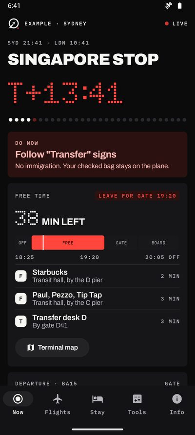
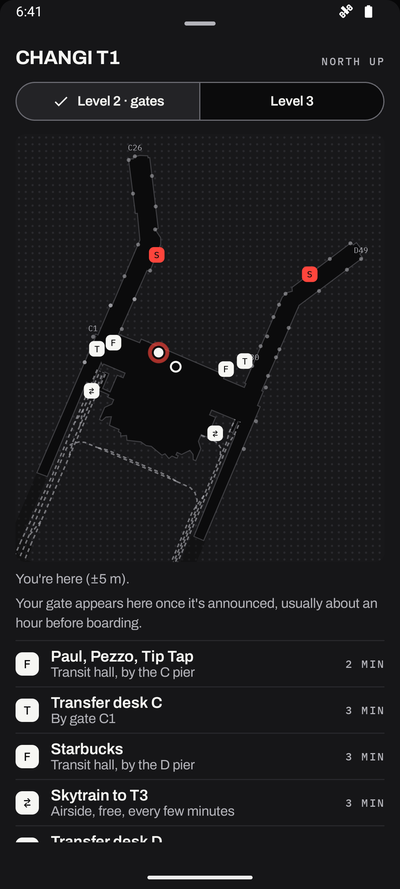
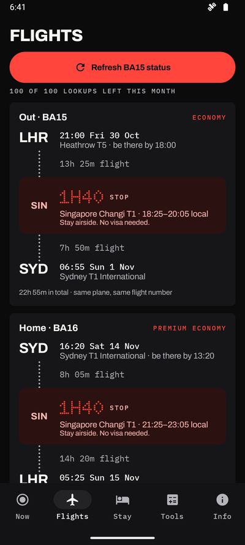
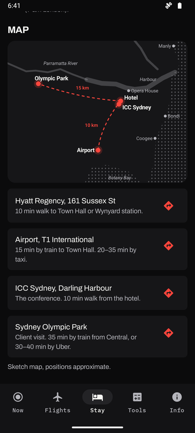
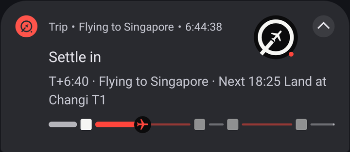
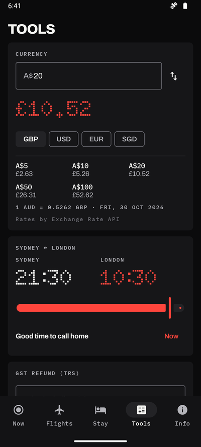
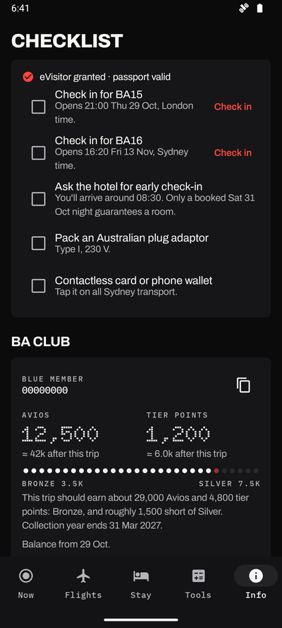

# Trip planner

Tell your coding agent about a trip; get a personal app for it on your phone, Android or iPhone.

A live "what to do now" timeline, a lock-screen status card, flight gates and gate-change alerts,
terminal maps with your GPS position, your hotel and places, and travel tools — built from your
booking details, checked leg by leg, and installed for you.

<p align="center">
  
  
  
  
</p>
<p align="center">
  
</p>

## Setup prompt

Paste into Claude Code, Codex, or any agent with shell access:

```text
Set up https://github.com/digitaljohn/trip-planner for me.

Read install.md first. It covers:
- cloning the repo
- checking Java and the Android SDK (ask me before installing anything big)
- registering the skill with whichever agent you're running under
- setting up the Aviationstack key (ask me to paste it when you need it)

Then read SKILL.md for how trips work.

After install, don't start a trip. Just tell me it's ready and wait.
```

Then start your agent wherever you like and tell it about the trip, from any source it can reach:

> set up my Sydney trip — the booking confirmations are in my Gmail

> here are my flights and hotel: [pasted itinerary, PDFs, screenshots]

> my trip's in my calendar for next week; build me the app

Booking emails, calendar events, documents in a connected drive, files on disk, or details typed
into the chat all work, in any mix.

It reads your bookings, asks for anything missing, plays the trip back to you in plain English,
waits for your OK, builds the app, checks every leg on an emulator, and installs it on your phone.
Everything for the trip is kept in its own folder (it suggests `~/Trips/<trip>/` unless you're
already in one): the trip itself (`MyTrip.kt`), your private numbers
(`trip.properties`), notes for next time (`project.md`) and the app (`out/trip.apk`). This repo
never holds anyone's trip.

## What's in the app

- **Now**: where you are in the trip, what to do, a countdown to the next step, and a free-time
  budget at each departure airport.
- **Lock screen**: an Android 16 Live Update with the current step, gate or belt, and progress.
- **Live flights**: gates, delays and belts from Aviationstack's free plan, with alerts when a gate
  is announced or changes, and an explicit refresh button. Lookups are rationed to the quota.
- **Terminal maps**: real outlines and gates from OpenStreetMap, with your GPS position, the route
  to your gate, trains between terminals, food, showers and smoking areas.
- **Home-screen widget**: the current step and a live countdown to the next one.
- **Boarding pass and hotel shortcuts**: Google Wallet or the airline's app in the 24 hours before
  each take-off, and transit directions to the hotel as you land.
- **Weather**: the stay's forecast from Open-Meteo (free, no key), and today's on the Now screen.
- **Stay, tools and info**: hotel, calendar and sketch map; currency, time and tax-refund tools;
  check-in links and alerts; references, contacts, loyalty and eSIM cards.

### On iPhone

The same app, built from the same code and the same trip folder, with the iPhone's own versions of
the system parts:

- **Lock screen**: a Live Activity (lock screen and Dynamic Island) instead of the Android 16 Live
  Update. iOS ends a Live Activity after about 8 hours; opening the app starts a fresh one.
- **Alerts**: step and check-in alerts are scheduled ahead, so they arrive on time even with the app
  closed. Gate, delay and belt alerts need a fresh lookup, which iOS runs in the background only when
  it chooses (often every 15–60 minutes, sometimes much less), so they can arrive later than on
  Android. Opening the app checks straight away. Check-in alerts can't be pinned until Done.
- **Widget, wallet, maps**: a WidgetKit home-screen widget (added from the home screen's Edit menu),
  Apple Wallet for boarding passes, Apple Maps for directions.
- **Airline, loyalty and eSIM app buttons** need the trip to give each app's iPhone link
  (`iosApp`); without one, check-in opens the airline's website and the other buttons are hidden.
- **Installing** needs a Mac with Xcode and an Apple developer team (a free Apple ID works, but the
  app then stops opening after 7 days until it's reinstalled).

<p align="center">
  
  
</p>

The repo ships with a made-up London → Singapore → Sydney trip in `trip/` as the worked example;
the screenshots are of it (Android).


## Manual install

```bash
git clone https://github.com/digitaljohn/trip-planner ~/Developer/trip-planner
ln -sfn ~/Developer/trip-planner ~/.claude/skills/trip-planner      # Claude Code
cd ~/Developer/trip-planner
cp local.properties.example local.properties                         # set sdk.dir and aviationstack.key
tools/build_trip.sh trip                                             # builds the example; needs JDK 17
tools/build_trip.sh trip --ios                                       # the iPhone app, for the simulator; needs Xcode
```

To build a trip folder yourself: copy `trip/MyTrip.kt` into it, edit, add a `trip.properties`
(see `local.properties.example` for the keys), then `tools/build_trip.sh <folder> --install` for an
Android phone or `--ios-install` for an iPhone (set `ios.team` first).

## Layout

```
SKILL.md, install.md      the agent skill and its first-time setup
AGENTS.md                 how the app is built, for changing the app itself
trip/MyTrip.kt            the example trip
shared/src/commonMain/kotlin/app/trip/   the app, for both platforms (Kotlin Multiplatform, Compose)
  TripModel.kt            the types a trip is written in
  Timeline.kt             legs, steps and "what to do now"
  Schedule.kt             which flight to watch, when, and which alerts fresh data calls for
  Terminals.kt            airport terminals the maps know
  TerminalData.kt         generated from OpenStreetMap
  Net.kt, Weather.kt      live flight data, rates, forecast
  Ui.kt, Flights.kt, Stay.kt, Tools.kt, Terminal.kt   screens
  Platform.kt, Time.kt    what each platform supplies; java.time names for trips
shared/src/androidMain/   Android: lock-screen Live Update, alarms, widget, notifications
shared/src/iosMain/       iPhone: notifications, Live Activity and widget data
app/                      the Android app shell (app id and name)
iosApp/                   the iPhone app shell, widget and Live Activity (SwiftUI; Xcode project)
skills/add-terminal-map/  sub-skill: add an airport
tools/                    build_trip.sh, map generator, OSM fetcher, screen-text check
docs/screenshots/         README images, of the example trip
```

Map data © OpenStreetMap contributors (ODbL). Exchange rates by ExchangeRate-API. Weather by
Open-Meteo.com (CC BY 4.0).
